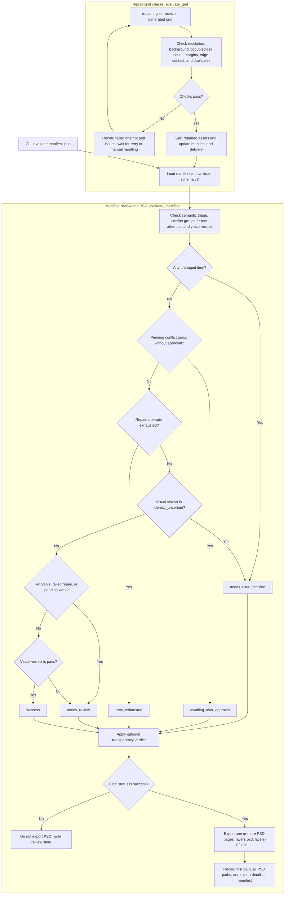

# Evaluator Pipeline

This diagram covers the two evaluator paths: deterministic checks for generated repair grids, and manifest review with the primary-review gate for layered PSD export.

## Evaluation criteria and evaluator index

Use the same three-part description for each category: **method → dimension → keywords**. The evaluator index links to the implementation; host visual review is not performed by Python and `evaluate_manifest()` only consumes its verdict.

| Method | Dimension | Keywords / criteria | Evaluator method (source index) |
|---|---|---|---|
| Deterministic grid check | Repair-grid integrity | Resolution (at least 512 px per cell); expected vs. occupied count; background consistency; edge contact; safe margin (at least 8%); possible duplicate shapes are reported for review. | [`evaluate_grid()`](../src/ultrasplitter/evaluator.py#L27) |
| Host multimodal visual review | Inventory and visual consistency | Reconcile the confirmed inventory with delivered assets (no missing or extra subjects); compare each asset with the source for identity, pose, silhouette, color, material, ornament, and no redesign. | Host review; [`evaluate_manifest()`](../src/ultrasplitter/evaluator.py#L115) consumes `visual_verdict` but does not inspect images. |
| Manifest gate | Workflow eligibility | Schema version 3; completed semantic triage; approved conflict groups; repair-attempt limit; required visual verdict is `pass`. | [`require_v3()`](../src/ultrasplitter/contracts.py#L48), [`evaluate_manifest()`](../src/ultrasplitter/evaluator.py#L115) |
| Transparent-variant check and review | Alpha integrity and compositing quality | Real alpha channel; transparent background; non-empty foreground; no edge contact; at least 8% safe margin; interior transparency is flagged for visual review; preview on white, black, and checkerboard. | [`inspect_transparent_candidate()`](../src/ultrasplitter/transparency.py#L60), [`apply_transparent_verdict()`](../src/ultrasplitter/transparency.py#L199); primary success is enforced by [`evaluate_manifest()`](../src/ultrasplitter/evaluator.py#L115). |
| PSD export | Delivery integrity | Native-pixel layers; pages stay within 30,000 px per side; oversized assets are tiled; paths and export details are recorded in the manifest. | [`export_layered_psd()`](../src/ultrasplitter/layered_psd.py#L119) |

Deterministic checks apply to generated repair grids; they do not certify semantic identity. Possible duplicate shapes are reported as evidence and still require review. The visual verdict comes from the host review, while the manifest gate controls whether that verdict and other workflow state permit delivery.

`ultrasplit run` creates and routes the manifest; it does not itself pass the evaluation gate. The CLI `evaluate` command, or repair ingestion after a successful grid check, calls `evaluate_manifest` and can reach PSD export.
