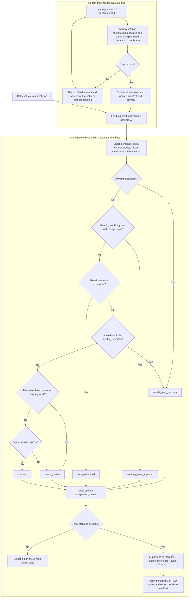

# Evaluator Pipeline

This diagram covers the two evaluator paths: deterministic checks for generated repair grids, and manifest review with the primary-review gate for layered PSD export.

`ultrasplit run` creates and routes the manifest; it does not itself pass the evaluation gate. The CLI `evaluate` command, or repair ingestion after a successful grid check, calls `evaluate_manifest` and can reach PSD export.
