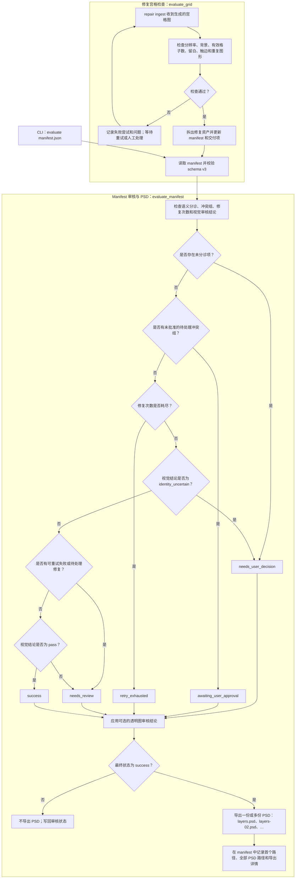

# Evaluator 评估流程

本图包含两条路径：对生成式修复宫格进行确定性检查，以及审核 manifest 并在主资产审核通过后导出分层 PSD。

## 评估标准与 evaluator 方法索引

各类标准统一按 **方法 → 维度 → 关键词** 表述。方法索引链接到对应实现；主资产的视觉审查由宿主模型完成，不在 Python evaluator 中执行；`evaluate_manifest()` 只接收并处理视觉结论。

| 方法 | 维度 | 关键词 / 标准 | 对应 evaluator 方法（源码索引） |
|---|---|---|---|
| 确定性宫格检查 | 修复宫格完整性 | 分辨率（每格至少 512 px）；预期格数与有效格数一致；背景一致性；触边；安全留白（至少 8%）；可能重复的图形会被标记供复核。 | [`evaluate_grid()`](../src/ultrasplitter/evaluator.py#L27) |
| 宿主多模态视觉审查 | 清单完整性与视觉一致性 | 将已确认清单与交付素材核对（不漏项、不多项）；逐件对照源图检查身份、姿态、轮廓、颜色、材质、装饰，以及是否发生重设计。 | 宿主完成审查；[`evaluate_manifest()`](../src/ultrasplitter/evaluator.py#L115) 接收 `visual_verdict`，不负责看图。 |
| Manifest 门控 | 流程交付资格 | schema 版本为 3；语义分诊完成；冲突组已批准；修复次数未耗尽；要求视觉结论为 `pass`。 | [`require_v3()`](../src/ultrasplitter/contracts.py#L48)、[`evaluate_manifest()`](../src/ultrasplitter/evaluator.py#L115) |
| 透明版本校验与审查 | Alpha 完整性与合成质量 | 存在真实 Alpha 通道；背景透明；前景非空；主体不触边；安全留白至少 8%；内部透明区域会标记并要求视觉复核；在白底、黑底、棋盘格上预览。 | [`inspect_transparent_candidate()`](../src/ultrasplitter/transparency.py#L60)、[`apply_transparent_verdict()`](../src/ultrasplitter/transparency.py#L199)；[`evaluate_manifest()`](../src/ultrasplitter/evaluator.py#L115) 负责主资产通过后的状态门控。 |
| PSD 导出 | 交付完整性 | 图层保留原像素；每份画布单边不超过 30,000 px；超大素材切块；路径和导出信息写入 manifest。 | [`export_layered_psd()`](../src/ultrasplitter/layered_psd.py#L119) |

确定性检查针对生成式修复宫格，不代表语义身份正确。可能重复的图形只作为检查证据返回，仍需复核。视觉结论由宿主审查给出；manifest 门控结合该结论和流程状态决定能否交付。

`ultrasplit run` 负责生成并路由 manifest，本身不会通过审核门控。CLI 的 `evaluate` 命令，或修复宫格检查通过后的导入流程，会调用 `evaluate_manifest` 并可能进入 PSD 导出。
